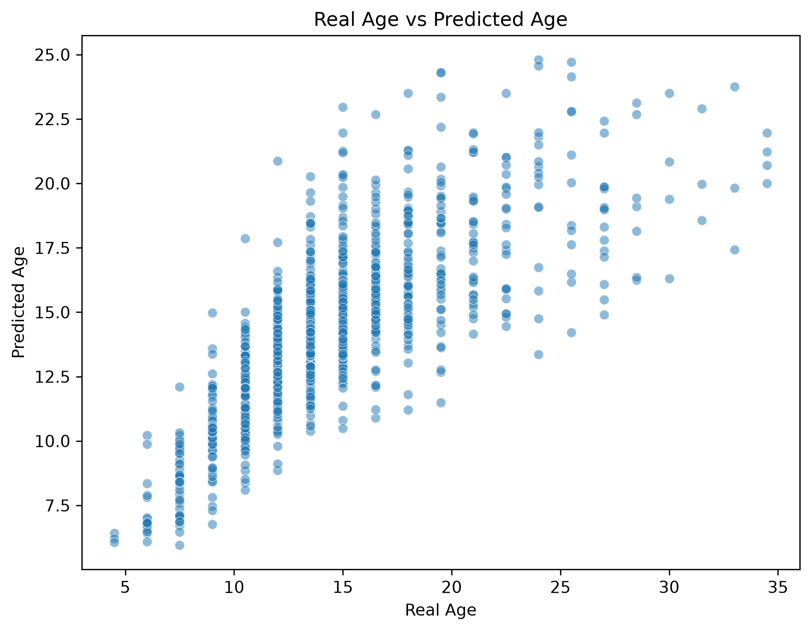
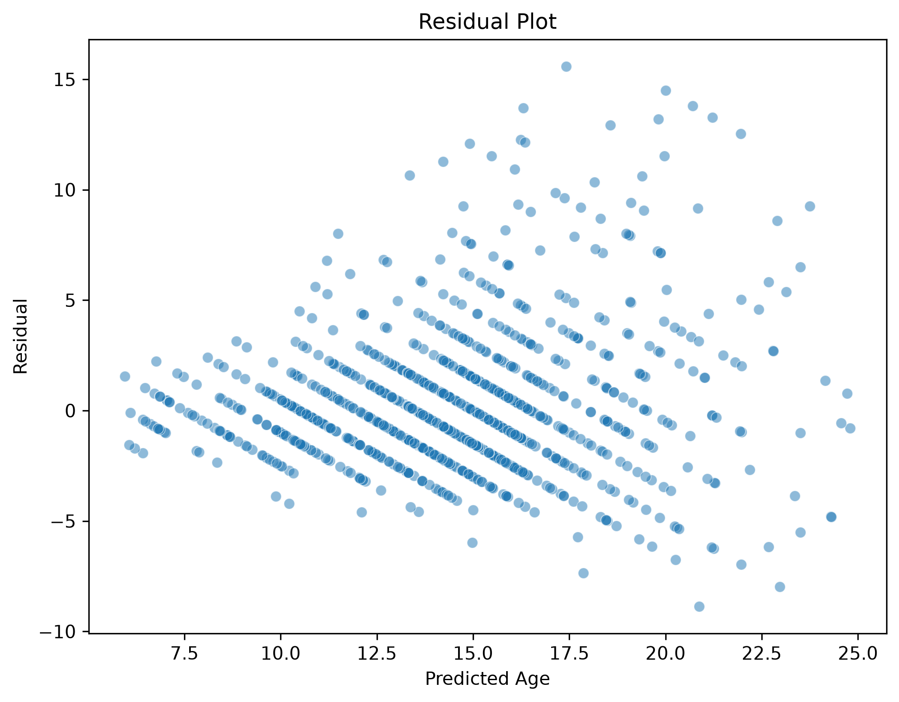
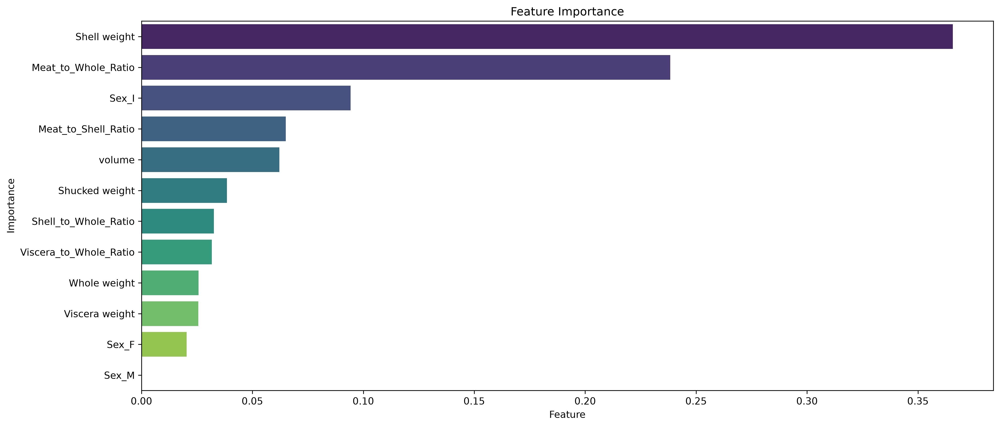

# Abalone Age Prediction with XGBoost

An end-to-end Machine Learning project designed to predict the age of abalones accurately using an optimized `XGBRegressor` model. This project emphasizes strict data hygiene, domain-driven feature engineering, L1 loss optimization, baseline comparison, and visual diagnostics.

## 📌 Project Overview

Determining the age of an abalone traditionally requires cutting the shell through the cone, staining it, and counting the number of rings under a microscope—a tedious and time-consuming process. This project builds a predictive pipeline that takes physical and biometric measurements (such as sex, dimensions, and weight distributions) to estimate abalone age (`Rings * 1.5`) non-invasively and with solid precision.

## ⚙️ Dataset

The dataset used to train and evaluate this model is the classic Abalone dataset (UCI Machine Learning Repository / Kaggle):
- **Source:** [UCI Machine Learning Repository - Abalone Dataset](https://archive.ics.uci.edu/dataset/1/abalone)

## 🚀 Key Features & Methodology

1. **Data Preprocessing & Hygiene**:
   * Inspected dataset integrity (checking null and duplicate values) and converted ring counts into estimated age (`Rings * 1.5`).
   * Applied a strict `train_test_split` prior to any transformations to prevent data leakage.
   * Handled the categorical `Sex` feature (`M`, `F`, `I`) using `OneHotEncoder`.

2. **Feature Engineering**:
   * Engineered a `volume` feature by multiplying `Length`, `Diameter`, and `Height`, replacing the raw spatial dimensions to capture physical scaling.
   * Created biological weight proportion ratios: `Shell_to_Whole_Ratio`, `Meat_to_Whole_Ratio`, `Meat_to_Shell_Ratio`, and `Viscera_to_Whole_Ratio` to capture body composition across growth stages.

3. **Model & Loss Optimization**:
   * Trained an `XGBRegressor` configured with `objective='reg:absoluteerror'` (L1 loss) and tuned hyperparameters via `GridSearchCV` (`n_estimators=50`, `max_depth=3`, `learning_rate=0.08`, `subsample=0.8`).
   * Validated performance against a mean-based `DummyRegressor` baseline to confirm the predictive gain of the gradient boosting pipeline.

4. **Diagnostic Visualizations**:
   * Generated visual diagnostics including Real vs. Predicted scatter plots, Residual plots, and Feature Importance bar charts to evaluate error distribution and predictor influence.

## 📊 Model Performance & Results

Our optimized `XGBRegressor` achieved strong, consistent metrics on the validation dataset:

- **Validation MAE (Mean Absolute Error):** **~2.21 years** (The model deviates by roughly 2.2 years on average per specimen).
- **Validation MAPE (Mean Absolute Percentage Error):** **~14.0%** (A reliable relative error rate across young and adult abalone specimens).
- **Baseline Comparison:** Substantially outperforms the simple mean-based `DummyRegressor` baseline, confirming the value of biometric weight ratios and L1-regularized gradient boosting.

### Why does this approach work well?
1. **Robust Handling of Skewness & Heteroscedasticity:** Using `objective='reg:absoluteerror'` optimizes toward the conditional median rather than the mean, preventing rare, very old specimens from skewing predictions across the rest of the population.
2. **Biometric Signal Extraction:** Engineered proportions like `Meat_to_Whole_Ratio` alongside `Shell weight` capture anatomical maturity far better than raw measurements alone.
3. **Leak-Free Evaluation:** Splitting the data before encoding and feature creation ensures that validation metrics reflect genuine generalization performance.

## 📈 Visual Diagnostics

Here are the diagnostic plots generated during model evaluation:

### 1. Real Age vs. Predicted Age
This scatter plot demonstrates how closely our model's predictions align with actual abalone ages across young and adult specimens.


### 2. Residual Plot
The residual distribution shows errors centered near zero across the main age range, highlighting natural variance growth in older specimens.


### 3. Feature Importance
This chart highlights which attributes drive age prediction the most according to the XGBoost algorithm, led by `Shell weight` and `Meat_to_Whole_Ratio`.


## 📁 Repository Structure

```text
abalone-age-prediction/
│
├── data/                      # Dataset folder
│   └── abalone.csv
│
├── figures/                   # Visual diagnostic figures
│   ├── real_vs_predicted.png
│   ├── residual_plot.png
│   └── feature_importance.png
│
├── app.py                     # Main execution script
├── requirements.txt           # Project dependencies
└── README.md                  # Project documentation
```

## ⚙️ Installation & Usage

1. **Clone the repository:**
   ```bash
   git clone https://github.com/NeryRdz/abalone-age-prediction.git
   cd abalone-age-prediction
   ```

2. **Install dependencies:**
   ```bash
   pip install -r requirements.txt
   ```

3. **Run the script:**
   ```bash
   python app.py
   ```
