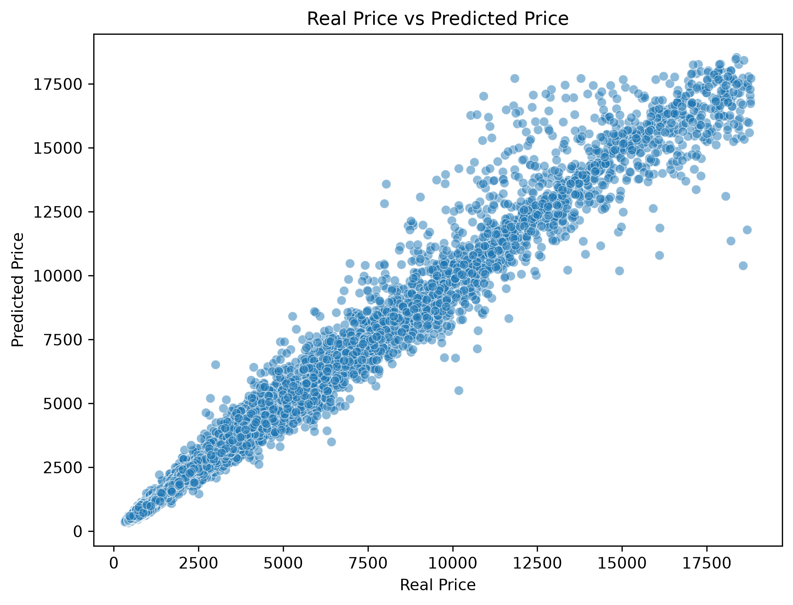
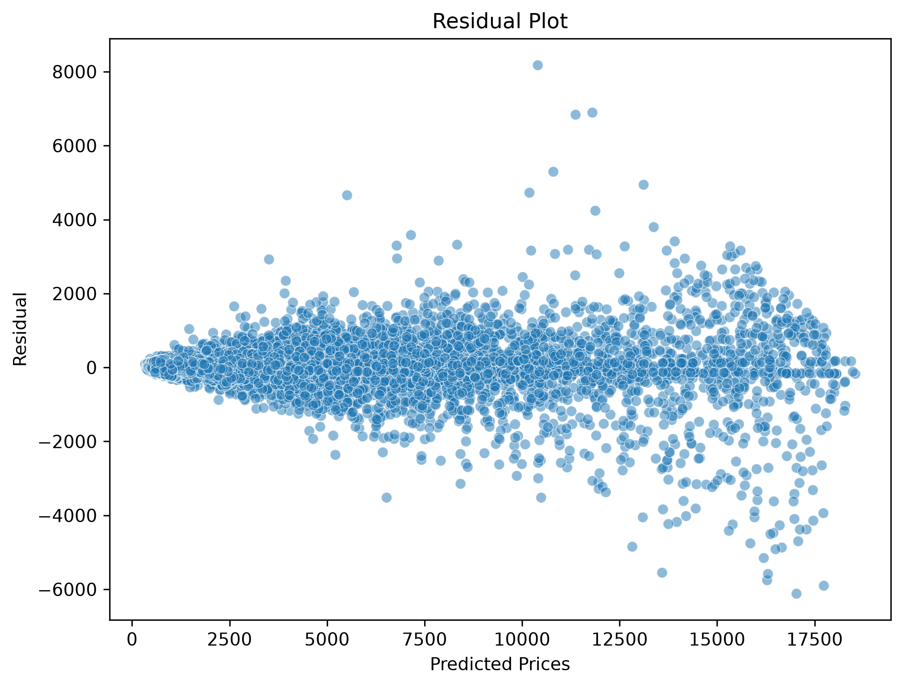
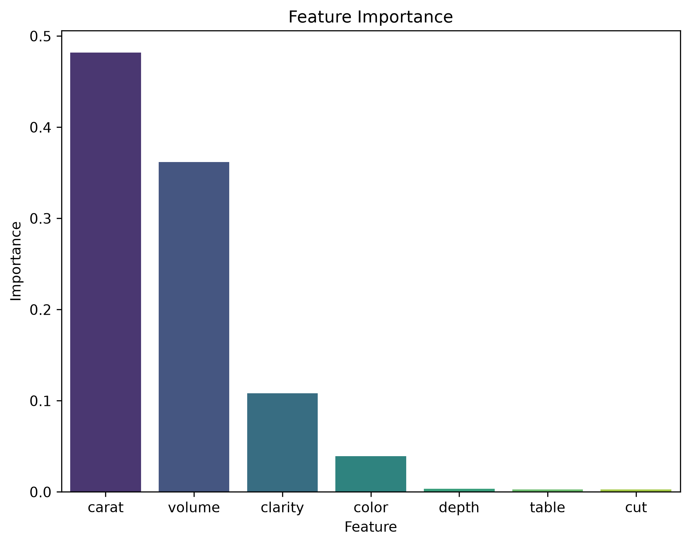

# Diamond Price Prediction with XGBoost

An end-to-end Machine Learning project designed to predict diamond prices accurately using an optimized `XGBRegressor` model. This project emphasizes rigorous data hygiene, feature engineering, baseline comparison, professional-grade evaluation metrics, and visual diagnostics.

## 📌 Project Overview

Valuing diamonds accurately is essential in the jewelry industry. This project builds a predictive pipeline that takes diamond characteristics (such as cut, color, clarity, and physical dimensions) and estimates market prices with high precision.

## 🚀 Key Features & Methodology

1. **Data Preprocessing & Hygiene**:
   * Eliminated the index column to prevent data leakage.
   * Handled categorical variables using `OrdinalEncoder` respecting natural hierarchies (`cut`, `color`, `clarity`).

2. **Feature Engineering**:
   * Engineered a new `volume` feature by multiplying length (`x`), width (`y`), and depth (`z`), replacing the raw spatial columns to improve model interpretability and capture physical scaling.

3. **Model Optimization**:
   * Trained an `XGBRegressor` with optimized hyperparameters (`n_estimators=500`, `max_depth=20`, `learning_rate=0.1`, `subsample=1.0`).
   * Validated performance against a `DummyRegressor` baseline to confirm the profound value added by the tree-based gradient boosting model.

4. **Diagnostic Visualizations & Serialization**:
   * Generated visual checks including Real vs. Predicted scatter plots, Residual plots, and Feature Importance bar charts.
   * Integrated `joblib` support to save and load the trained model and ordinal encoder for deployment purposes.

## 📊 Model Performance & Results

Our optimized XGBRegressor achieved outstanding metrics on the validation dataset:

* **Validation MAE (Mean Absolute Error):** **$282.59** (The model deviates by roughly \$282 on average per diamond).
* **Validation MAPE (Mean Absolute Percentage Error):** **~8%** (An exceptional single-digit relative error rate across diverse price ranges).
* **Baseline Comparison:** Drastically outperforms a simple mean-based `DummyRegressor`, proving the high predictive power of the engineered features and gradient boosting architecture.

### Why is this model so good?
1. **Exceptional Generalization:** An 8% MAPE indicates that whether evaluating an affordable stone or a high-end luxury diamond, the percentage error remains consistently low.
2. **Robust Handling of Non-Linearity:** XGBoost effectively captures complex interactions between diamond carat weight, physical volume, and the ordinal quality grades (cut, color, and clarity).
3. **Honest Evaluation:** By eliminating data leakage early in development, we ensure these low error rates are genuine and will hold up reliably in real-world scenarios.

## 📈 Visual Diagnostics

Here are the diagnostic plots generated during model evaluation:

### 1. Real Price vs. Predicted Price
This scatter plot demonstrates how closely our model's predictions align with actual market prices along a diagonal trend line.


### 2. Residual Plot
The residual distribution indicates balanced errors without systematic bias across different price spectrums.


### 3. Feature Importance
This chart highlights which attributes drive diamond pricing the most according to the XGBoost algorithm.


## 📁 Repository Structure

```text
diamond-price-prediction/
│
├── data/                      # Dataset folder
│   └── diamonds.csv
│
├── models/                    # Saved model artifacts (.pkl)
│   ├── xgb_diamond_model.pkl
│   └── ordinal_encoder.pkl
│
├── figures/                   # Visual diagnostic figures
│   ├── real_vs_predicted.png
│   ├── residual_plot.png
│   └── feature_importance.png
│
├── script.py                  # Main execution script
├── requirements.txt           # Project dependencies
└── README.md                  # Project documentation
```

## ⚙️ Installation & Usage

1. **Clone the repository:**
   ```bash
   git clone https://github.com/NeryRdz/diamond-price-prediction.git
   cd diamond-price-prediction
   ```

2. **Install dependencies:**
   ```bash
   pip install -r requirements.txt
   ```

3. **Run the script:**
   ```bash
   python script.py
   ```
